# HUD Desk

**Read your agent sessions, email and chats on G2. Talk, type on a Bluetooth keyboard, open pictures.**

HUD Desk (formerly Orca Glass, renamed 2026-11-27) connects Even Realities G2 glasses to the Claude Code and Codex sessions on your Windows PC or Mac (with or without Orca), to Gmail or any IMAP/SMTP mailbox, and to Beeper chats. The top row on the glasses switches between Coding, Email and Chat. Agents, mail, chats, voice transcription and the picture reader all run on your PC; the phone and the glasses only display and send.

This is Eugene's Windows/Android fork of [2ero20ne's Orca Glass](https://github.com/2ero20ne/orca-glass), licensed under MIT. It is developed and tested with the Even Realities app on Android; the Even Hub app has no Android-specific code, but it has not been tried on an iPhone. The plugin ID stays `com.eugene8080.orcaglass`.

## Availability

As of 2026-11-27 the Even Hub **public build is 1.0.36** (Coding only, connects only to the developer's PC) and the **beta is 1.0.94**. 1.0.94 was submitted for public review on 2026-11-27. Email, Chat, pictures, the keyboard and self-hosting need 1.0.94.

See [current work](TODOS.md), [beta setup and release history](docs/beta-install.md) and the [feature list](store/features.md).

## Set up on your PC

Run the one-command setup, then paste the pairing code into HUD Desk on your phone. The bridge runs on your computer and connects through your private Tailscale network; the phone needs Tailscale too. Use a phone build that supports address-carrying pairing codes (1.0.94 or later). [Windows setup](docs/self-host.md) · [macOS setup](docs/self-host-macos.md) (not yet run on a real Mac)

## Features

**Coding (Claude Code and Codex, with or without Orca)**
- [Plain Claude Code and Codex CLI sessions](docs/local-agents.md) without Orca; through Orca also Cursor, OpenCode, Pi, OpenClaude and Hermes Agent, with model and status. Orca chat sessions are listed read-only (the Orca CLI cannot send to a chat).
- Filter by Agent and by one or more Orca workspaces; rows show `[workspace/Agent]`. Usage for Codex, Claude and Cursor drawn as bars, with reset times.
- Book-style reader: whole-page swipes, `/` your turns, `>` replies, one status row with model, activity animation, timer and page.
- Hold to talk: local Whisper on the PC, review, then click to send. Numbered prompts open as choices.

**Email (Gmail, or any IMAP/SMTP account: [setup](docs/email-providers.md))**
- One mailbox at a time (work or personal), Filter by Label with voice or typed search. Opening a thread marks it read.
- With a Bluetooth keyboard: compose, reply, reply all, forward, archive, delete, star and undo with Gmail's keys. Drafts show on the glasses; review, then send.
- Pictures in mail, including newsletter images fetched over HTTPS when you open them (ad and tracking images skipped).

**Chat (Beeper Desktop: WhatsApp, Signal, Telegram and more)**
- Rows show the day and the app, e.g. `[27Nov/Signal]`; Filter by Network. Chat formatting (lists, quotes, line breaks) shown as plain text.
- Voice notes transcribed on the PC (FunASR, tuned for Cantonese). Translate puts English on the row under each foreign line, through a local Ollama model.
- Photos open on the glasses.

**Pictures**
- AI Labels (charts): the local AI reads every printed line of a chart and HUD Desk draws it back in place in Scientifica 5x11, so titles, ticks and notes become readable. [How it works](docs/pictures.md)
- Original Picture tuned for the G2's 16 green levels (flat tones for charts and screenshots, thin edges and dithering for photos), Zoom in sections, and AI Readout: a local Ollama vision model describes the picture as text.

**Keyboard**
- Gmail-style keys everywhere; VS Code-style `Ctrl+P`, `Ctrl+Shift+P`, `Ctrl+Tab`, `Ctrl+F`, `Ctrl+,`; `?` shows every key on the glasses.

**Reader**
- Native text or pixel fonts (Departure, Misc Fixed, Terminus, GohuFont, Scientifica 5x11 at 114 columns) with Hong Kong Chinese and Japanese glyphs; aligned Markdown tables; backgrounds for your turns (lines, dots, Tube scanlines, 1px frame, left bar, underline, dim replies); App Brightness. Choose fonts and backgrounds on their comparison pages.
- Interface in English and Japanese (chosen in the phone app).

Other agents may appear in the session list and filters, but discovery does not guarantee full reader support. Tool output, internal reasoning and terminal chrome are filtered. New-session creation remains Codex-only.

### Hermes support (beta 1.0.28)

Browse live and saved sessions from the existing authenticated local Hermes gateway.
Sessions group as Hermes regardless of model. Verified Orca ownership supplies the
workspace; other sessions appear under `Hermes: <profile>`. Saved reading filters
hidden scaffolding, tools and reasoning. Reviewed voice replies target the exact
captured profile/session and reject stale ownership. The bridge does not start
Hermes or create sessions. Physical G2 and a real user-confirmed Hermes reply
still need verification. See [implementation](docs/hermes-bridge.md).

## Screenshots

Native 576 × 288 simulator captures of beta 1.0.91 (Coding list and charts: 1.0.95) with fictional sample data. The chart is invented data drawn by `scripts/make-store-chart.py`; its AI Readout is the local vision model's real answer (see the [gallery](store/gallery.html)). The picture is a Mandelbrot set drawn by ffmpeg; the keys page is rendered by the app's own code.

| **Reader: Scientifica 5x11 on Tube** | **Architecture map** | **Live coding** |
| --- | --- | --- |
| 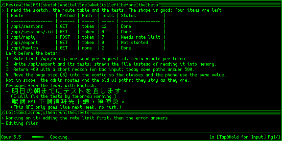 | 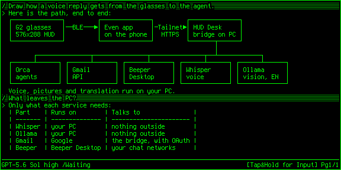 | 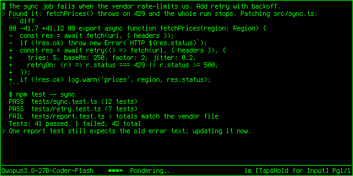 |
| **Coding sessions** | **Reader: native text** | **Voice review** |
| 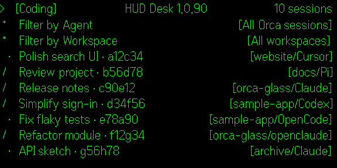 | 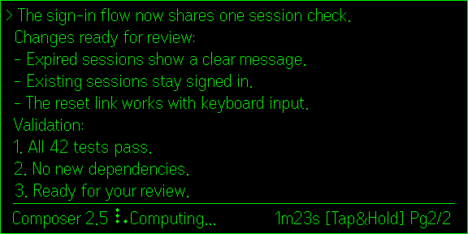 | 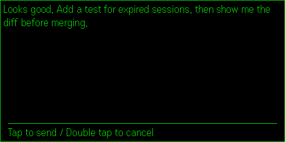 |
| **Email** | **Email with pictures** | **Original Picture** |
| 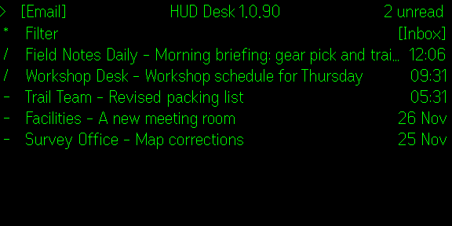 | 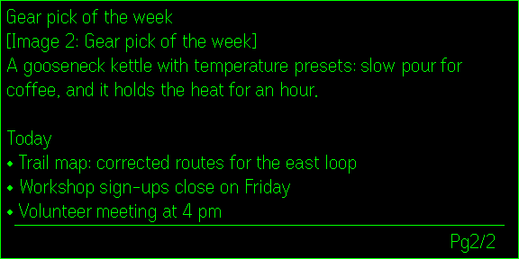 | 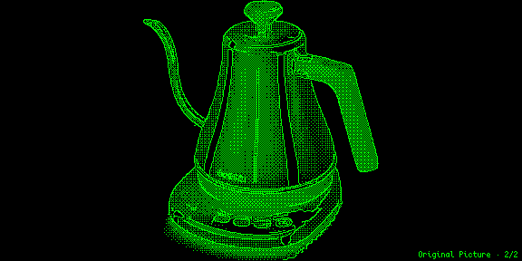 |
| **Usage bars** | **AI Readout** | |
| 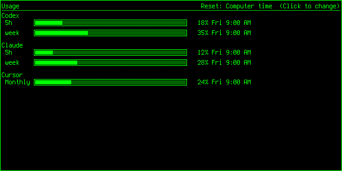 | 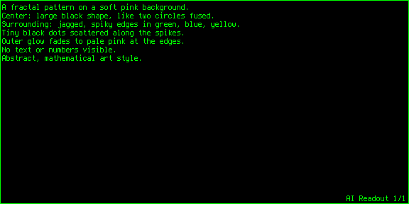 | |
| **Chart on the G2** | **Chart: AI Labels** | **Chart: AI Readout** |
| 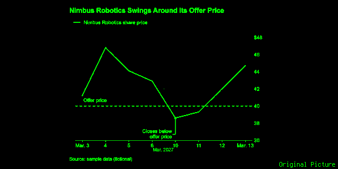 | 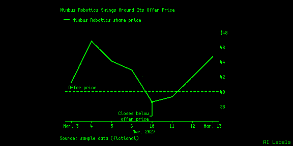 | 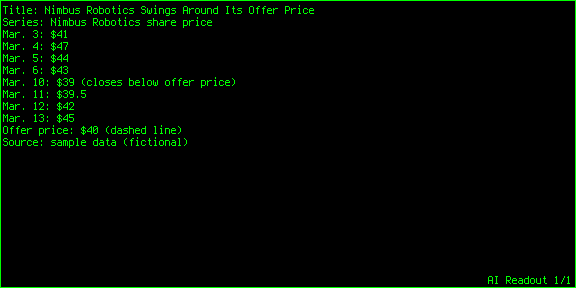 |
| **Chat** | **Filter by Network** | **Chat translation** |
| 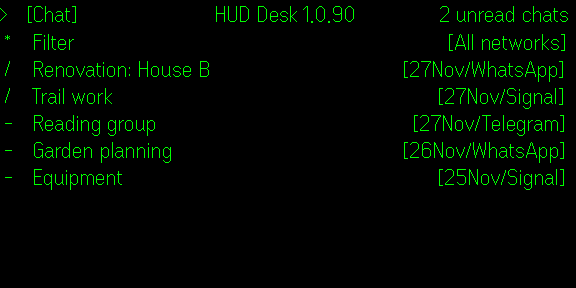 | 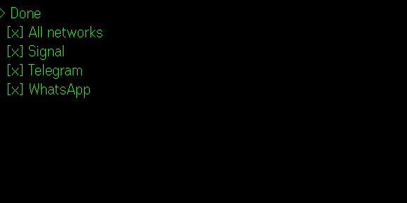 | 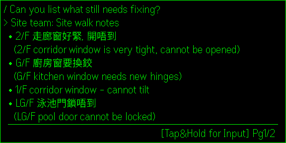 |
| **Keyboard keys** | **Compare backgrounds** | **Compare fonts** |
| 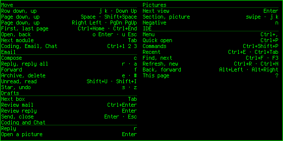 | 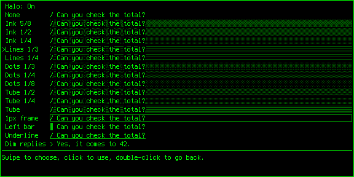 | 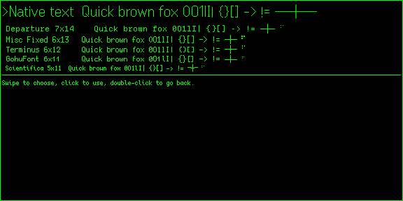 |

The simulator omits OS contextual entries. See [store listing notes](store/listing.md).

## Development

Requirements: Node.js 22+. The development build's Coding module supports Orca or [plain Claude Code and Codex CLI sessions](docs/local-agents.md). Voice needs local Whisper. Email needs a Gmail OAuth client ([docs/email.md](docs/email.md)); Chat needs Beeper Desktop with its API on ([docs/chat.md](docs/chat.md)); pictures and voice notes need ffmpeg; Translate and AI Readout need Ollama with a vision-capable model. Windows is the primary verified environment; macOS setup is documented separately. The installed beta and earlier Quick Tunnel prototype use different network routes.

**Windows**

```powershell
npm --prefix app ci
npm test
npm --prefix app run build
npm run doctor
```

Voice: `pwsh -File scripts/setup-voice.ps1` (add `-Multilingual` for Japanese UI voice).

**macOS**

```bash
npm ci --prefix app
npm test
npm --prefix app run build
npm run doctor
```

Voice: `bash scripts/setup-voice.sh` (add `--multilingual` for Japanese). Startup: `bash scripts/install-macos-startup.sh install`. Details: [docs/macos.md](docs/macos.md).

Run development servers and the simulator in named terminals inside this repo's Orca workspace (PowerShell on Windows). See [project instructions](CLAUDE.md), [voice implementation](docs/voice-input.md), [reader behavior](docs/session-reader.md) and [session-list behavior](docs/session-list.md).

Pairing codes are credentials: keep them, authenticated QR files and local runtime settings out of Git and screenshots. Audio travels through the phone to the configured PC for local transcription. A confirmed reply is sent to the selected desktop agent, whose own provider/data policies then apply. Earlier prototype routes use Cloudflare and ntfy; the personal installed beta uses the configured Tailscale connection.

## License

[MIT](LICENSE). Original copyright: **Copyright (c) 2026 2ero20ne**.
Production builds include the full original notice in `LICENSE.txt` and project
links in `ATTRIBUTION.txt`. This independent fork does not imply upstream endorsement.

The small-text reader uses Fusion Pixel Font 12px monospaced zh_HK for the shared CJK glyph table, with public-domain Shinonome fallbacks. The build includes both fonts' notices in `FONT-LICENSES.txt`. The verified source BDF has SHA-256 `994fddade92110721113e56e23be2e01a356d8ed6f1b261f41ce3d8d7d2c255c`. To rebuild just the wide table, run `python scripts/build-fine-fonts.py --wide-only --fusion <zh_HK BDF> --shinonome <Shinonome BDF directory>`. [Fusion Pixel Font v2026.11.10](https://github.com/TakWolf/fusion-pixel-font/releases/tag/2026.11.10)
